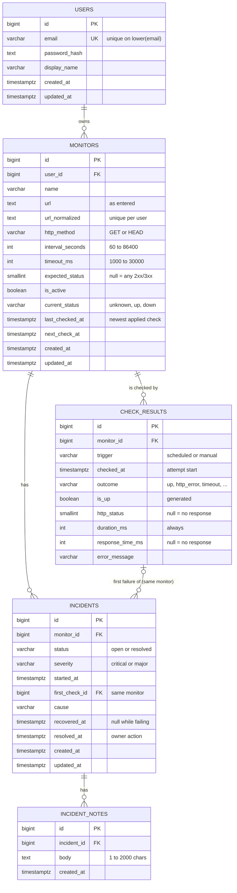

# PulseOps database design (PULSE-25)

**Status:** Revision 2, draft for review. This is not approved, and it does not authorize implementation.
**Author:** Mirla · **Reviewer:** Carlo (PULSE-59)
**Covers:** PULSE-56 (ERD), PULSE-57 (fields, keys, constraints), PULSE-58 (indexes, history, incident rules)
**Product source:** PRD v1.1, draft dated 19 Nov 2026 (Notion: https://www.notion.so/41a4cd9e492d80429fe9fca7d4197128), requirements R1–R5 and rules BR-01 to BR-05
**Files:**
- [`schema.sql`](schema.sql) creates the tables.
- [`verify.sql`](verify.sql) runs positive and negative checks against them (section 9).

Anything marked **PROPOSAL** is a product decision that the PRD's *Decisions needed before approval* table has not settled yet (section 8). The schema supports it, but the team still has to agree on it.

## 0. What changed since revision 1 (response to the PR #1 review)

| # | Review point | Change |
|---|---|---|
| P1 | BR-04/R5: a successful check must not close an incident | Incidents now have their own `status` (`open` / `resolved`). A successful check only records `recovered_at` (recovery evidence). Only the owner's resolve action sets `resolved`, and the database rejects it unless recovery evidence exists |
| P2 | R5: severity, status and notes | Added `incidents.status`, `incidents.severity` (**PROPOSAL**: values and rule) and a new `incident_notes` table |
| P3 | R2: reject duplicate URLs per user | Added `monitors.url_normalized`, unique per user. The database enforces it, so it also holds under concurrency. Equivalence rules are a **PROPOSAL** (section 3.3) |
| P4 | Accounts and notifications are already decided | Removed both open questions. Personal accounts are in (R1); notifications are out of scope (PRD 5.2) |
| P5 | 30-day retention is not a product rule | No automatic deletion in the MVP. Retention stays a **PROPOSAL** that needs team agreement (section 3.5) |
| P6 | Response time when there is no HTTP response | `duration_ms` (elapsed attempt) is always stored. `http_status` and `response_time_ms` are stored only when a response arrived, and a CHECK forbids a made-up latency. The PRD's acceptance wording is still open (section 3.4) |
| T1 | An incident could reference another monitor's check | Composite FK `(monitor_id, first_check_id) → check_results(monitor_id, id)` with `ON DELETE SET NULL (first_check_id)`. Negative cases are in `verify.sql` |
| T2 | Concurrent and stale check completions | A per-monitor row lock is taken on completion, and only results newer than `last_checked_at` are applied. Scheduled claims use `FOR UPDATE SKIP LOCKED` (section 4) |
| T3 | Prisma mapping claim | Removed "maps directly". Section 6 now covers version pinning, hand-written SQL for features Prisma can't express, and a parity check |
| T4 | BIGINT in JSON | The API sends IDs as decimal strings (section 7) |
| A1 | Align with the API contract (PR #5) | Added `UNIQUE (user_id, name)` for `409 DUPLICATE_MONITOR_NAME`. Both the original `url` and `url_normalized` are stored; which one the API returns is left to PULSE-26 |

## 1. Entity relationship diagram



## 2. Tables

Conventions:
- Primary keys are `BIGINT GENERATED ALWAYS AS IDENTITY`.
- Every timestamp is `TIMESTAMPTZ`, stored in UTC.
- Names are `snake_case`.
- Allowed values use `CHECK` constraints, not Postgres enums, so they're easy to change in a migration.

### users (R1)
| Column | Type | Null | Rules |
|---|---|---|---|
| id | BIGINT identity | no | PK |
| email | VARCHAR(254) | no | Unique on `lower(email)`; must contain `@` |
| password_hash | TEXT | no | A password hash only, never the plain password |
| display_name | VARCHAR(100) | yes | |
| created_at, updated_at | TIMESTAMPTZ | no | |

### monitors (R2)
| Column | Type | Null | Rules |
|---|---|---|---|
| id | BIGINT identity | no | PK |
| user_id | BIGINT | no | FK → users, cascade |
| name | VARCHAR(100) | no | Display label, trimmed by the API. **`UNIQUE (user_id, name)`** (API contract `409 DUPLICATE_MONITOR_NAME`) |
| url | TEXT | no | As the user entered it; must start with http(s):// |
| url_normalized | TEXT | no | Canonical form computed by the API. **`UNIQUE (user_id, url_normalized)`** |
| http_method | VARCHAR(4) | no | `GET` (default) or `HEAD` |
| interval_seconds | INTEGER | no | 60–86400. Default 300 is a **PROPOSAL** |
| timeout_ms | INTEGER | no | 1000–30000, default 10000 |
| expected_status | SMALLINT | yes | NULL means any 2xx/3xx counts as up |
| is_active | BOOLEAN | no | Paused monitors are not scheduled |
| current_status | VARCHAR(7) | no | `unknown` (R4: "not yet checked"), `up`, `down`. Endpoint health only, not incident state |
| last_checked_at | TIMESTAMPTZ | yes | `checked_at` of the newest check that was **applied** (section 4) |
| next_check_at | TIMESTAMPTZ | no | When the scheduler should claim it next |

### check_results (R3, R4)
| Column | Type | Null | Rules |
|---|---|---|---|
| id | BIGINT identity | no | PK. Also `UNIQUE (monitor_id, id)` for the composite FK |
| monitor_id | BIGINT | no | FK → monitors, cascade |
| trigger | VARCHAR(9) | no | `scheduled` or `manual` (R3). Both use the same rules |
| checked_at | TIMESTAMPTZ | no | When the attempt **started** |
| outcome | VARCHAR(16) | no | `up`, `http_error`, `timeout`, `connection_error`, `dns_error`, `blocked` (the target resolved to a private address at check time; BR-02) |
| is_up | BOOLEAN | generated | `outcome = 'up'` |
| http_status | SMALLINT | yes | Present **only** when an HTTP response arrived (`up` or `http_error`) |
| duration_ms | INTEGER | no | Elapsed attempt time. Always recorded, even with no response |
| response_time_ms | INTEGER | yes | HTTP response latency. Present only with `http_status`, and ≤ `duration_ms` |
| error_message | VARCHAR(500) | yes | Short reason when not up |

### incidents (R5)
| Column | Type | Null | Rules |
|---|---|---|---|
| id | BIGINT identity | no | PK |
| monitor_id | BIGINT | no | FK → monitors, cascade |
| status | VARCHAR(8) | no | `open` (default) or `resolved`. **At most one `open` per monitor** (BR-03) |
| severity | VARCHAR(8) | no | `critical` or `major`. Decided in PULSE-112 (section 3.2) |
| started_at | TIMESTAMPTZ | no | `checked_at` of the first failing check |
| first_check_id | BIGINT | yes | Must be a check of **the same monitor** (composite FK). NULL only if that check was deleted |
| cause | VARCHAR(500) | yes | Copied from the first failing check |
| recovered_at | TIMESTAMPTZ | yes | Set when a newer successful check is applied; cleared if it fails again before resolution. Must be ≥ `started_at` |
| resolved_at | TIMESTAMPTZ | yes | Set only by the owner's resolve action. Present exactly when status = `resolved`, and must be ≥ `recovered_at` |

### incident_notes (R5)
| Column | Type | Null | Rules |
|---|---|---|---|
| id | BIGINT identity | no | PK |
| incident_id | BIGINT | no | FK → incidents, cascade |
| body | TEXT | no | 1–2000 characters after trimming |
| created_at | TIMESTAMPTZ | no | |

Only the incident's owner can add notes (BR-01), so no separate author column is needed in the MVP.

## 3. Rules

### 3.1 Ownership (BR-01)
- Ownership is stored once, in `monitors.user_id`. Checks, incidents and notes are owned by the owner of their monitor.
- **The API must filter every query by the signed-in user.** If a user asks for someone else's resource, the API returns `404`, so it doesn't reveal that the resource exists. *(Exact codes are confirmed in PULSE-26.)*
- The composite FK means an incident can't point at a check from another monitor. That rules out pointing at another owner's check too.

### 3.2 Incident lifecycle (R5, BR-03, BR-04)

```text
            failing check (no open incident)
   (none) ───────────────────────────────▶ OPEN, recovered_at = NULL
                                             │  ▲
                 newer successful check      │  │ newer failing check   (PROPOSAL: same
                 sets recovered_at           ▼  │ clears recovered_at    incident continues)
                                    OPEN, recovered_at set
                                             │
                 owner "resolve" action      │ allowed only when recovered_at is set
                                             ▼
                                         RESOLVED  (history and notes stay visible, BR-05)
```

- **Creation:** a failing check on a monitor with no open incident inserts one. The partial unique index `incidents (monitor_id) WHERE status = 'open'` guarantees one open incident even when two completions race. The insert uses `ON CONFLICT … DO UPDATE`.
- **Recovery is not resolution:** a successful check only sets `recovered_at`. It never changes `status`.
- **Resolution:** the API's resolve endpoint checks ownership, then sets `status = 'resolved', resolved_at = now()`. The database rejects it unless `recovered_at` is set (`incidents_resolve_needs_recovery`). If the endpoint failed again after recovering, `recovered_at` is NULL again, so resolving is rejected ("still failing", PRD R5).
- **Re-failure before resolution (PROPOSAL, PRD decision owned by Carlo with Majd):** the same open incident continues and `recovered_at` is cleared. A failure after resolution opens a new incident.
- **Severity (decided in PULSE-112; the API contract uses the same values):** set once, from the first failing check:
  - `critical` when there was no HTTP response (`timeout`, `connection_error`, `dns_error`, `blocked`)
  - `major` when the server answered with an unexpected status (`http_error`)

  The values and the rule live in one CHECK constraint, so they're easy to change.

### 3.3 Duplicate URLs (R2), PROPOSAL (owned by Gaelle with Mirla)
The API computes `url_normalized` before insert or update. The proposed rules:
1. Lower-case the scheme and host.
2. Drop the default port (`:80` for http, `:443` for https).
3. Use `/` when the path is empty.
4. Drop the `#fragment`.
5. Keep the rest of the path and the query string exactly as entered.

`http` and `https` stay different URLs. Uniqueness is enforced by `UNIQUE (user_id, url_normalized)`, so two concurrent creates or edits can't both succeed. The API turns the violation into a `409` duplicate message. Different users may monitor the same URL.

### 3.4 What a check records (R3, PRD "honest failure display")
- Every attempt stores `duration_ms`, the elapsed time from start until it finished or gave up.
- `http_status` and `response_time_ms` exist **only** when an HTTP response arrived. CHECK constraints forbid a status or latency for `timeout`, `connection_error`, `dns_error` and `blocked`.
- `outcome` also records the **failure type** (Gaelle's PULSE-34 review, UN-2) without new tables.
- **Open (PRD, owned by Carlo with Majd and Mirla):** whether the 10-check acceptance test counts `duration_ms` as "a response time" when there is no response. The schema stores both values, so either answer works without a migration.

### 3.5 History retention (BR-05)
- **The MVP deletes nothing automatically.** Check history and incidents stay visible after resolution (BR-05).
- **PROPOSAL (owned by Carlo with Majd and Mirla):** if the team agrees on a retention window for check results, the cleanup job deletes old rows in batches.
  - Incidents and notes are never deleted by it.
  - `incidents.cause` keeps the reason.
  - `ON DELETE SET NULL (first_check_id)` only clears the link, as tested.
- Sizing for that discussion: one monitor checked every 300 s makes about 8,600 rows a month.

## 4. Check completion and concurrency (review point T2)

Endpoint health (`monitors.current_status`) and incident state are updated together, and **only by the newest result**.

**Claiming scheduled work**, so two workers never check the same monitor for the same slot:
```sql
WITH due AS (
  SELECT id FROM monitors
  WHERE is_active AND next_check_at <= now()
  ORDER BY next_check_at
  LIMIT 20
  FOR UPDATE SKIP LOCKED
)
UPDATE monitors m SET next_check_at = now() + make_interval(secs => m.interval_seconds)
FROM due WHERE m.id = due.id
RETURNING m.id, m.url, m.http_method, m.timeout_ms, m.expected_status;
```

**Completing a check.** Manual and scheduled checks use the same procedure, in one transaction:
1. `SELECT last_checked_at FROM monitors WHERE id = $m FOR UPDATE;` This serializes all completions for this monitor.
2. Insert the `check_results` row. **Every result is kept in history**, including late ones.
3. Apply the result only if it is newer:
   ```sql
   UPDATE monitors SET current_status = $status, last_checked_at = $checked_at
   WHERE id = $m AND (last_checked_at IS NULL OR last_checked_at < $checked_at);
   ```
   If no row was updated, the result is **stale**: stop here (commit), and change nothing else.
4. If it was applied and the check **failed**:
   ```sql
   INSERT INTO incidents (monitor_id, severity, started_at, first_check_id, cause)
   VALUES ($m, $severity, $checked_at, $check_id, $error)
   ON CONFLICT (monitor_id) WHERE status = 'open'
   DO UPDATE SET recovered_at = NULL, updated_at = now();
   ```
5. If it was applied and the check **succeeded**:
   ```sql
   UPDATE incidents SET recovered_at = $checked_at, updated_at = now()
   WHERE monitor_id = $m AND status = 'open' AND recovered_at IS NULL;
   ```

Why this is safe:
- The row lock in step 1 means completions for one monitor run one after another.
- The `last_checked_at < $checked_at` guard means a late result can't overwrite newer status, and can't open, recover or affect an incident.
- Incidents are never closed by the worker, so the old "resolved before started" rollback can't happen.

Which process runs the worker, and how many, is an architecture decision (PULSE-24).

## 5. Indexes

| Index | Columns | Purpose |
|---|---|---|
| `users_email_lower_uq` (unique) | `lower(email)` | Login lookup; no duplicate accounts that differ only by case |
| `monitors_user_url_uq` (unique) | `(user_id, url_normalized)` | R2 duplicate rejection, safe under concurrency |
| `monitors_user_name_uq` (unique) | `(user_id, name)` | Duplicate monitor names per user (API contract), safe under concurrency |
| `monitors_user_idx` | `(user_id)` | Dashboard: "my monitors" |
| `monitors_due_idx` (partial) | `(next_check_at) WHERE is_active` | Scheduler claim query |
| `check_results_monitor_id_uq` (unique) | `(monitor_id, id)` | Target of the same-monitor composite FK |
| `check_results_monitor_time_idx` | `(monitor_id, checked_at DESC)` | Latest checks and history for a monitor (R4) |
| `check_results_checked_at_idx` | `(checked_at)` | Batch cleanup, only if retention is agreed |
| `incidents_one_open_per_monitor_uq` (partial unique) | `(monitor_id) WHERE status = 'open'` | BR-03; also finds the open incident quickly |
| `incidents_monitor_started_idx` | `(monitor_id, started_at DESC)` | Incident history per monitor |
| `incidents_first_check_idx` (partial) | `(monitor_id, first_check_id)` | Makes FK checks and SET NULL fast when a check is deleted |
| `incident_notes_incident_idx` | `(incident_id, created_at)` | Notes of an incident, in order |

## 6. Prisma and migrations (review point T3)

- **Pin the version.** PULSE-69 adds `prisma` and `@prisma/client` with an **exact** version (no `^` or `~`), committed with `package-lock.json`. Upgrades happen in their own PR.
- **Not everything fits `schema.prisma`.** At least these features need hand-written SQL in the migration:
  - the CHECK constraints
  - the `lower(email)` expression index
  - the partial indexes (`WHERE is_active`, `WHERE status = 'open'`)
  - `ON DELETE SET NULL (first_check_id)` on the composite FK
  - the generated `is_up` column

  If the pinned Prisma version supports one of them natively, use that. Otherwise:
  1. Create the migration with `prisma migrate dev --create-only`.
  2. Add the missing statements from `schema.sql` to the generated `migration.sql`.
  3. Review it in the PR.
- **Prove parity.** In CI, or by hand before merging a migration PR:
  1. Apply all migrations to an empty database.
  2. Run `verify.sql`; it must print `ALL CHECKS PASSED`.
  3. Compare the result with `schema.sql`, for example with `prisma migrate diff` or `pg_dump --schema-only`. Differences must be explained in the PR.

## 7. How the API represents these values (review point T4)

- **IDs are sent as decimal strings** in JSON (`"id": "42"`) and accepted as strings, because `BIGINT` can exceed JavaScript's safe integer range. The backend never converts them to `Number`.
- Timestamps are ISO 8601 in UTC. Status, outcome and severity values are sent exactly as stored.
- The final shapes belong to the REST contract (PULSE-26).

## 8. Decisions still open

These are the PRD's *Decisions needed before approval*, plus one schema-level choice.

| Decision | Current schema choice | Owner (from the PRD) |
|---|---|---|
| Response time when there is no HTTP response | Stores both `duration_ms` and nullable `response_time_ms` | Carlo with Majd and Mirla |
| Severity values and rule | **Decided (PULSE-112):** `critical` / `major`, set from the first failing check | – |
| URL equivalence | Rules in section 3.3 | Gaelle with Mirla |
| Default check interval | 300 s (allowed 60–86400) | Carlo with Majd and Mirla |
| History retention | None in the MVP; cleanup only if agreed | Carlo with Majd and Mirla |
| Re-failure after recovery but before resolution | Same incident continues | Carlo with Majd |
| Worker process model | Any number of workers (claim + completion procedure) | PULSE-24 (Majd) |

## 9. Verification

`verify.sql` runs inside one transaction and rolls back at the end, so it leaves nothing behind. It checks:
- duplicate email (by case)
- duplicate URL per user, on create **and** edit; another user may use the same URL
- duplicate monitor name per user
- non-http URL
- fabricated latency or status
- an incident pointing at another monitor's check, on insert **and** update
- a second open incident
- resolving while still failing
- `resolved` without `resolved_at`
- recovery not closing an incident
- resolving after recovery
- a blank note
- a stale result not overwriting newer status
- deleting a check nulls only `first_check_id`
- cascades on user delete

**How to run it:**
```powershell
psql -d pulseops_scratch -f docs/database/schema.sql -f docs/database/verify.sql
```
You can also open both files in pgAdmin's Query Tool and run them in order, on an empty database.

**Result so far:**
- On **PostgreSQL 18.6** (PGlite, an embedded Postgres): `ALL CHECKS PASSED`.
- A separate script (not committed) also ran the full completion procedure from section 4: 24 of 24 cases passed, including repeated failures, recovery, re-failure, resolution and a stale late result.
- It has **not** yet been run on the team's PostgreSQL 18.7 install. That run, and the parity check in section 6, belong to PULSE-69.

## 10. Review checklist (PULSE-25)

- [x] ERD covers users, monitors, check results, incidents and incident notes, aligned with PRD v1.1
- [x] Tables specify types, primary and foreign keys, required fields and constraints
- [x] Ownership, history retention and incident rules are documented
- [x] Indexes and their purpose are identified
- [ ] Carlo reviews revision 2 (PULSE-59); the open decisions in section 8 are agreed with their owners
- [ ] API contract (PULSE-26) cross-checked
