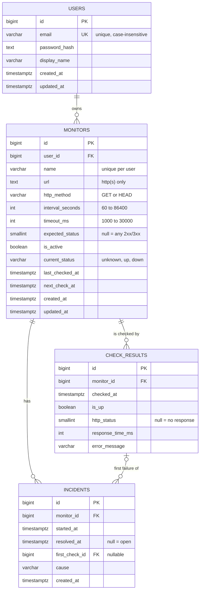

# PulseOps database design (PULSE-25)

**Status:** Draft, waiting for Carlo's review
**Author:** Mirla · **Reviewer:** Carlo
**Covers:** PULSE-56 (ERD), PULSE-57 (fields, keys, constraints), PULSE-58 (indexes, retention, incident rules)
**SQL:** [`schema.sql`](schema.sql). It runs cleanly on an empty PostgreSQL database.

> The PRD (PULSE-19) and REST API contract (PULSE-26) are not final yet. This design assumes the MVP is:
> a user signs in, adds HTTP(S) URLs to monitor, a worker checks them on a schedule,
> and the dashboard shows status, response times, uptime and incidents.
> Items marked **[Assumption]** or listed under *Open questions* must be confirmed against the PRD and API.

## 1. Entity relationship diagram



GitHub renders this diagram automatically.

## 2. Tables

General conventions:
- Primary keys are `BIGINT GENERATED ALWAYS AS IDENTITY`.
- Every timestamp is `TIMESTAMPTZ`, stored in UTC.
- Names are `snake_case`.
- Allowed values are enforced with `CHECK` constraints, not Postgres enums, so they're easy to change in a migration.

### users
| Column | Type | Null | Rules |
|---|---|---|---|
| id | BIGINT identity | no | PK |
| email | VARCHAR(254) | no | Unique on `lower(email)`; must contain `@` |
| password_hash | TEXT | no | bcrypt/argon2 hash only. Never the plain password |
| display_name | VARCHAR(100) | yes | |
| created_at, updated_at | TIMESTAMPTZ | no | default `now()`; the backend sets `updated_at` |

### monitors
| Column | Type | Null | Rules |
|---|---|---|---|
| id | BIGINT identity | no | PK |
| user_id | BIGINT | no | FK → users.id, `ON DELETE CASCADE` |
| name | VARCHAR(100) | no | Unique per user `(user_id, name)` |
| url | TEXT | no | Must start with `http://` or `https://` |
| http_method | VARCHAR(4) | no | `GET` (default) or `HEAD` |
| interval_seconds | INTEGER | no | 60–86400, default 300 **[Assumption]** |
| timeout_ms | INTEGER | no | 1000–30000, default 10000 **[Assumption]** |
| expected_status | SMALLINT | yes | 100–599. NULL means any 2xx/3xx counts as up |
| is_active | BOOLEAN | no | default true. Paused monitors are skipped by the worker |
| current_status | VARCHAR(7) | no | `unknown` (default), `up`, `down`. A cached copy of the latest result, so the dashboard doesn't have to scan history |
| last_checked_at | TIMESTAMPTZ | yes | NULL until the first check |
| next_check_at | TIMESTAMPTZ | no | default `now()`, so a new monitor is checked straight away |
| created_at, updated_at | TIMESTAMPTZ | no | |

### check_results
| Column | Type | Null | Rules |
|---|---|---|---|
| id | BIGINT identity | no | PK |
| monitor_id | BIGINT | no | FK → monitors.id, `ON DELETE CASCADE` |
| checked_at | TIMESTAMPTZ | no | default `now()` |
| is_up | BOOLEAN | no | The worker decides this using `expected_status` |
| http_status | SMALLINT | yes | 100–599. NULL when there was no response (timeout, DNS or TLS error) |
| response_time_ms | INTEGER | yes | ≥ 0 |
| error_message | VARCHAR(500) | yes | Short reason when down |

Rule: an up result must have both `http_status` and `response_time_ms`.

### incidents
| Column | Type | Null | Rules |
|---|---|---|---|
| id | BIGINT identity | no | PK |
| monitor_id | BIGINT | no | FK → monitors.id, `ON DELETE CASCADE` |
| started_at | TIMESTAMPTZ | no | Time of the first failing check |
| resolved_at | TIMESTAMPTZ | yes | NULL means the incident is still open; must be ≥ `started_at` |
| first_check_id | BIGINT | yes | FK → check_results.id, `ON DELETE SET NULL` (the result may be deleted by retention later) |
| cause | VARCHAR(500) | yes | Copied from the first failing check, so it survives retention |
| created_at | TIMESTAMPTZ | no | |

## 3. Rules

### Ownership
- Each monitor belongs to exactly one user (`monitors.user_id`).
- Check results and incidents have no `user_id` of their own. Their owner is the owner of their monitor.
- **The API must filter every query by the signed-in user**, for example `JOIN monitors m ON m.id = cr.monitor_id WHERE m.user_id = $currentUser`. If a user asks for a monitor they don't own, the API returns `404`, not `403`, so it doesn't reveal that the monitor exists. *(To be confirmed in PULSE-26.)*
- Deleting a user deletes their monitors. Deleting a monitor deletes its check results and incidents (cascade).

### Check-history retention
- **[Assumption]** Check results are kept for **30 days**. Incidents are kept for the life of the monitor.
- A daily cleanup job deletes old results in batches, so it never holds long locks:
  ```sql
  DELETE FROM check_results
  WHERE id IN (SELECT id FROM check_results
               WHERE checked_at < now() - INTERVAL '30 days'
               LIMIT 5000);
  -- repeat until 0 rows are deleted
  ```
- Uptime % and response-time charts can only cover the retention window (≤ 30 days). Incidents still show older outages.
- Volume estimate: one monitor checked every 60 s produces about 43,000 rows per 30 days. With 100 monitors that's about 4.3 M rows, which PostgreSQL handles fine with the indexes below. Partitioning by month is a possible later step and isn't needed for the MVP.

### Open-incident consistency
- **The database enforces at most one open incident per monitor**, using the partial unique index `incidents_one_open_per_monitor_uq ON incidents (monitor_id) WHERE resolved_at IS NULL`. A second open incident is rejected even if two workers race.
- `resolved_at >= started_at` is enforced by a CHECK constraint.
- The worker does all of the following **in one transaction** for each check:
  1. Insert the `check_results` row.
  2. Update `monitors` with `current_status`, `last_checked_at`, and `next_check_at = now() + interval_seconds`.
  3. If the result is **down**, open an incident if none is open:
     `INSERT INTO incidents (monitor_id, started_at, first_check_id, cause) VALUES (...) ON CONFLICT (monitor_id) WHERE resolved_at IS NULL DO NOTHING;`
  4. If the result is **up**, close any open incident:
     `UPDATE incidents SET resolved_at = $checked_at WHERE monitor_id = $id AND resolved_at IS NULL;`
- Because all four steps commit together, `monitors.current_status = 'down'` and an open incident always appear together, and so do `up` and no open incident.

## 4. Indexes

| Index | Columns | Query it serves |
|---|---|---|
| `users_email_lower_uq` (unique) | `lower(email)` | Login lookup; stops duplicate accounts that differ only by case |
| `monitors_name_per_user_uq` (unique) | `(user_id, name)` | Stops duplicate monitor names for a user |
| `monitors_user_idx` | `(user_id)` | Dashboard: "my monitors" |
| `monitors_due_idx` (partial) | `(next_check_at) WHERE is_active` | Worker: `WHERE is_active AND next_check_at <= now()` |
| `check_results_monitor_time_idx` | `(monitor_id, checked_at DESC)` | Latest N results, uptime % and response times for one monitor over a window |
| `check_results_checked_at_idx` | `(checked_at)` | Retention cleanup by age |
| `incidents_one_open_per_monitor_uq` (partial unique) | `(monitor_id) WHERE resolved_at IS NULL` | Enforces one open incident; also finds the open incident fast |
| `incidents_monitor_started_idx` | `(monitor_id, started_at DESC)` | Incident history for a monitor |
| `incidents_first_check_idx` (partial) | `(first_check_id)` | Makes `ON DELETE SET NULL` fast when retention deletes results |

PostgreSQL does not create indexes on foreign-key columns automatically. Each FK above is covered by one of these indexes.

## 5. Open questions (for Carlo, Gaelle and the PRD)

1. Does the MVP need user accounts, or one shared admin? If there are no accounts, `users` and `user_id` are removed.
2. What are the minimum check interval and the retention period (60 s and 30 days are assumed)?
3. Should an incident open after **1** failed check or after **N** in a row (to avoid false alarms)? N > 1 would need a `consecutive_failures` counter on `monitors`.
4. Is the same URL allowed twice for one user? There is no unique constraint on it now.
5. Are notifications (email or webhook) in scope? They would need an extra `notification_channels` table.
6. Prisma or raw SQL migrations (PULSE-28 and PULSE-69)? This schema maps directly to a Prisma schema either way.

## 6. Review checklist (PULSE-25 acceptance criteria)

- [x] The ERD covers users, monitors, check results and incidents
- [x] Tables specify types, primary and foreign keys, required fields and constraints
- [x] Ownership, check-history retention and open-incident rules are documented
- [x] Indexes and their purpose are identified
- [ ] Carlo reviews consistency with the PRD and API, and the ERD is linked in Jira
